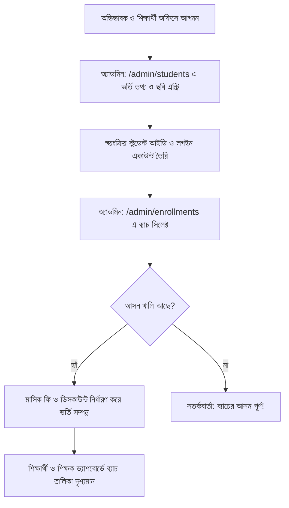
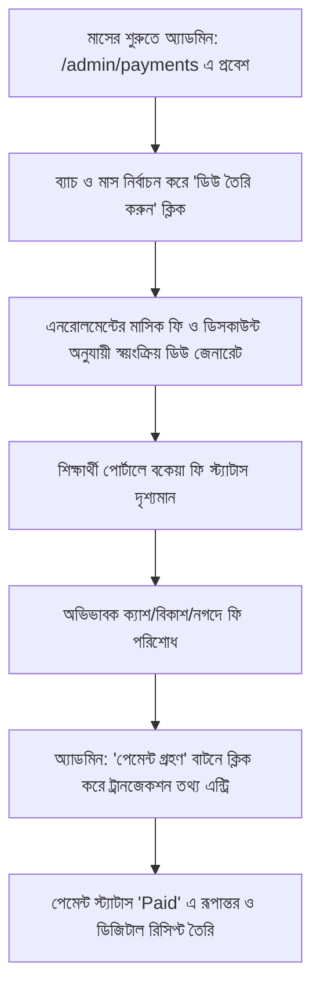
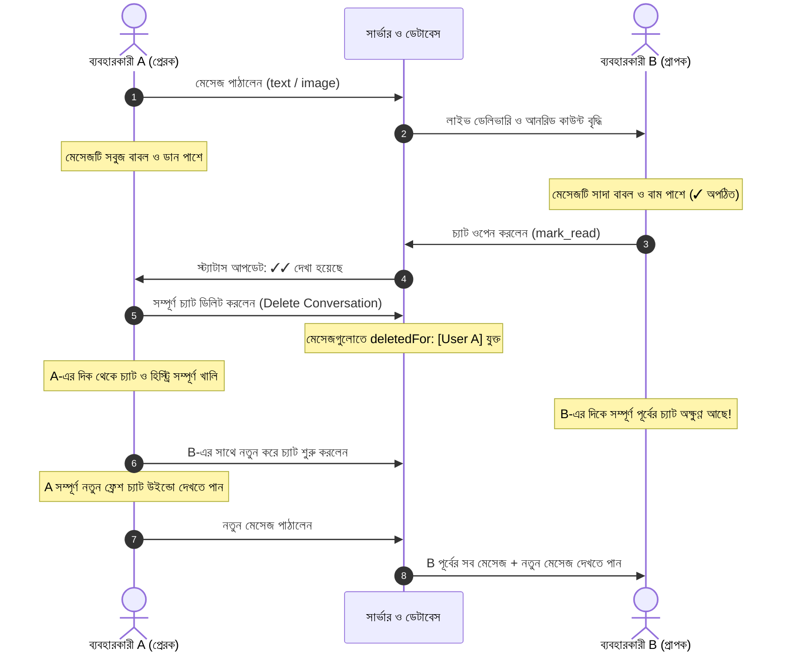

# 🎓 শিক্ষণ (Shikkhon) - আধুনিক কোচিং একাডেমিক কেয়ার প্ল্যাটফর্ম

একটি সম্পূর্ণ, স্কেলযোগ্য ও আধুনিক **কোচিং সেন্টার ম্যানেজমেন্ট ওয়েব অ্যাপ্লিকেশন**। এটি বাংলাদেশের শীর্ষস্থানীয় অফলাইন কোচিং ইনস্টিটিউট ও একাডেমিক কেয়ার পরিচালনার বাস্তব প্রেক্ষাপট, প্রাতিষ্ঠানিক শৃঙ্খলা এবং আধুনিক ওয়েব প্রযুক্তির সমন্বয়ে তৈরি করা হয়েছে।

সিস্টেমটিতে রয়েছে পাবলিক পোর্টাল, সুপার অ্যাডমিন ম্যানেজমেন্ট কনসোল, ডেডিকেটেড শিক্ষক পোর্টাল, শিক্ষার্থী পোর্টাল, রিয়েল-টাইম মেসেঞ্জার চ্যাট সিস্টেম, মাসিক ফি ও পেমেন্ট ট্র্যাকিং এবং লাইভ নোটিফিকেশন সেন্টার।

---

## 📑 সূচিপত্র (Table of Contents)

1. [🛠️ প্রযুক্তি স্ট্যাক (Technology Stack)](#️-প্রযুক্তি-স্ট্যাক-technology-stack)
2. [⚙️ সিস্টেম সেটআপ ও এনভায়রনমেন্ট কনফিগারেশন](#️-সিস্টেম-সেটআপ-ও-এনভায়রনমেন্ট-কনফিগারেশন)
3. [✨ মূল ফিচার ও বৈশিষ্ট্যসমূহ (Core Features)](#-মূল-ফিচার-ও-বৈশিষ্ট্যসমূহ-core-features)
4. [🔄 সামগ্রিক ব্যবহার প্রবাহ (End-to-End Usage Flows)](#-সামগ্রিক-ব্যবহার-প্রবাহ-end-to-end-usage-flows)
   - [৪.১ শিক্ষার্থী ভর্তি ও ব্যাচ এনরোলমেন্ট প্রবাহ](#৪১-শিক্ষার্থী-ভর্তি-ও-ব্যাচ-এনরোলমেন্ট-প্রবাহ)
   - [৪.২ মাসিক ফি জেনারেশন ও পেমেন্ট কালেকশন প্রবাহ](#৪২-মাসিক-ফি-জেনারেশন-ও-পেমেন্ট-কালেকশন-প্রবাহ)
   - [৪.৩ রিয়েল-টাইম চ্যাট ও পার-ইউজার হিস্ট্রি প্রবাহ](#৪৩-রিয়েল-টাইম-চ্যাট-ও-পার-ইউজার-হিস্ট্রি-প্রবাহ)
   - [৪.৪ নোটিফিকেশন বেল ও রিড-ট্র্যাকিং প্রবাহ](#৪৪-নোটিফিকেশন-বেল-ও-রিড-ট্র্যাকিং-প্রবাহ)
5. [🏛️ সুপার অ্যাডমিন ব্যবহারের পূর্ণাঙ্গ গাইডলাইন (Super Admin Guide)](#️-সুপার-অ্যাডমিন-ব্যবহারের-পূর্ণাঙ্গ-গাইডলাইন-super-admin-guide)
6. [👨‍🏫 শিক্ষক পোর্টাল ব্যবহারের পূর্ণাঙ্গ গাইডলাইন (Teacher Guide)](#-শিক্ষক-পোর্টাল-ব্যবহারের-পূর্ণাঙ্গ-গাইডলাইন-teacher-guide)
7. [👨‍🎓 শিক্ষার্থী পোর্টাল ব্যবহারের পূর্ণাঙ্গ গাইডলাইন (Student Guide)](#-শিক্ষার্থী-পোর্টাল-ব্যবহারের-পূর্ণাঙ্গ-গাইডলাইন-student-guide)
8. [🌐 পাবলিক ওয়েবসাইট ও কন্টেন্ট নেভিগেশন (Public Website)](#-পাবলিক-ওয়েবসাইট-ও-কন্টেন্ট-নেভিগেশন-public-website)
9. [⚡ রিয়েল-টাইম চ্যাট ও সকেট সার্ভার (Real-Time Communication)](#-রিয়েল-টাইম-চ্যাট-ও-সকেট-সার্ভার-real-time-communication)
10. [🧪 স্বয়ংক্রিয় টেস্ট ও বিল্ড ভ্যালিডেশন](#-স্বয়ংক্রিয়-টেস্ট-ও-বিল্ড-ভ্যালিডেশন)
11. [📞 যোগাযোগ ও সাপোর্ট (Support)](#-যোগাযোগ-ও-সাপোর্ট-support)

---

## 🛠️ প্রযুক্তি স্ট্যাক (Technology Stack)

- **ফ্রন্টএন্ড ও ফুলস্ট্যাক ফ্রেমওয়ার্ক**: [Next.js 16](https://nextjs.org/) (App Router, Turbopack, React 19, Server Components)
- **প্রোগ্রামিং ভাষা**: [TypeScript](https://www.typescriptlang.org/) (Strict Mode)
- **ব্যাকএন্ড ও এপিআই**: Next.js Native Route Handlers (`src/app/api/*`)
- **ডেটাবেজ ও ওআরএম**: [MongoDB](https://www.mongodb.com/) এবং [Mongoose](https://mongoosejs.com/)
- **ক্লাউড ইমেজ হোস্টিং**: [ImgBB API](https://api.imgbb.com/) ও মাল্টি-পার্ট ফর্ম আপলোডার
- **স্টাইলিং ও থিম**: [Tailwind CSS v4](https://tailwindcss.com/)
- **ক্লায়েন্ট স্টেট ম্যানেজমেন্ট**: [Redux Toolkit](https://redux-toolkit.js.org/) ও `react-redux`
- **রিয়েল-টাইম আর্কিটেকচার**: [Socket.IO](https://socket.io/) (Persistent Server + Polling Auto-Sync)
- **ফর্ম ভ্যালিডেশন**: [React Hook Form](https://react-hook-form.com/) ও [Zod](https://zod.dev/)
- **টাইপোগ্রাফি**: গুগল ফন্ট `Hind Siliguri` (বাংলা লিপি)
- **আইকন সেট**: [Lucide React](https://lucide.dev/)

---

## ⚙️ সিস্টেম সেটআপ ও এনভায়রনমেন্ট কনফিগারেশন

### ১. পূর্বশর্ত (Prerequisites)
- **Node.js**: v20 বা তার পরবর্তী সংস্করণ
- **MongoDB**: লোকাল MongoDB ইনস্টলেশন অথবা MongoDB Atlas ক্লাউড ক্লাস্টার

### ২. ডিপেন্ডেন্সি ইনস্টলেশন
```bash
npm install
```

### ৩. এনভায়রনমেন্ট ফাইল কনফিগারেশন (`.env.local`)
প্রজেক্টের রুট ডিরেক্টরিতে `.env.local` ফাইল তৈরি করুন বা নিচের মতো কনফিগার করুন:

```env
# MongoDB Connection String (Atlas অথবা Local)
MONGODB_URI=mongodb+srv://<username>:<password>@cluster0.mongodb.net/shikkhon?retryWrites=true&w=majority

# Authentication & Security
JWT_SECRET=super_secret_jwt_key_at_least_32_characters_long_2026_cms
JWT_EXPIRES_IN=7d

# Application URLs
NEXT_PUBLIC_APP_URL=http://localhost:3000
NEXT_PUBLIC_SOCKET_URL=http://localhost:3000

# ImgBB Cloud Image API Key
IMGBB_API_KEY=your_imgbb_api_key_here

# Super Admin Seeding Credentials (ঐচ্ছিক)
SUPER_ADMIN_PHONE=01866098078
SUPER_ADMIN_PASSWORD=AdminPass@2026
SUPER_ADMIN_NAME=প্রধান প্রশাসক (Super Admin)
```

### ৪. প্রথম সুপার অ্যাডমিন অ্যাকাউন্ট তৈরি
```bash
npm run seed:admin
```
- **মোবাইল**: `01866098078`
- **পাসওয়ার্ড**: `AdminPass@2026`

---

## ✨ মূল ফিচার ও বৈশিষ্ট্যসমূহ (Core Features)

| মডিউল | মূল বৈশিষ্ট্য ও কার্যকারিতা |
| :--- | :--- |
| **পাবলিক পোর্টাল** | হোম, শিক্ষক পরিচিতি, কোর্স ও ক্লাসের তালিকা, ভর্তি গাইডলাইন, নোটিশ বোর্ড, ফটো গ্যালারিসহ ইভেন্ট, ব্লগ এবং সরাসরি হোয়াটসঅ্যাপ ফ্লোটিং বাটন। |
| **রোল-বেজড অথেনটিকেশন** | সুপার অ্যাডমিন, অ্যাডমিন, শিক্ষক ও শিক্ষার্থীদের জন্য একক লগইন (`/login`) এবং ভূমিকা অনুযায়ী স্বয়ংক্রিয় পোর্টালে রিডাইরেকশন। |
| **শিক্ষার্থী ও শিক্ষক ব্যবস্থাপনা** | পাসপোর্ট সাইজের ছবি আপলোড, অটো-জেনারেটেড ইউনিক আইডি (যেমন: `STU-2026-0001`, `TCH-101`), অভিভাবকের জরুরি তথ্য ও পাসওয়ার্ড সেট। |
| **ব্যাচ ও ক্লাসরুটিন** | শ্রেণিভিত্তিক ব্যাচ তৈরি, আসন সংখ্যা নির্ধারণ (Seat Capacity Limit), বিষয়ভিত্তিক শিক্ষক অ্যাসাইন এবং সপ্তাহের নির্ধারিত ক্লাস রুটিন। |
| **ব্যাচ এনরোলমেন্ট ও ট্রান্সফার** | শিক্ষার্থীকে ব্যাচে ভর্তি, মাসিক ফি এবং ওয়েভার/ডিসকাউন্ট নির্ধারণ। পূর্বের ইতিহাস অক্ষুণ্ণ রেখে অন্য ব্যাচে ট্রান্সফার সুবিধা। |
| **ডিজিটাল হাজিরা** | সেশন, ব্যাচ ও তারিখ সিলেক্ট করে এক ক্লিকে সম্পূর্ণ ব্যাচের উপস্থিতি (Present/Absent/Late) গ্রহণ ও তাৎক্ষণিক পার্সেন্টেজ রিপোর্ট। |
| **পরীক্ষা ও ফলাফল** | ব্যাচভিত্তিক পরীক্ষা গ্রহণ, ওএমআর/লিখিত প্রাপ্ত নম্বর এন্ট্রি, লেটার গ্রেড (A+, A, B...) ও স্বয়ংক্রিয় মেধা তালিকা (Rank) প্রকাশ। |
| **মাসিক ফি ও পেমেন্ট** | ব্যাচের সকল শিক্ষার্থীর জন্য এক ক্লিকে মাসিক ডিউ তৈরি, ক্যাশ/বিকাশ/নগদ পেমেন্ট এন্ট্রি এবং ভাউচার রিসিপ্ট প্রিন্ট। |
| **রিয়েল-টাইম চ্যাট সিস্টেম** | ফেসবুক মেসেঞ্জার আদলের UX, মোবাইল রেসপনসিভ (ক্লিক করে চ্যাটে যাওয়া ও ব্যাক বাটন), সিন/আনসিন ডাবল টিক (`✓✓ দেখা হয়েছে`), আনরিড কাউন্টার, একতরফা ডিলিট ও ফ্রেশ চ্যাট স্টার্ট। |
| **ইন্টারেক্টিভ নোটিফিকেশন বেল** | শিক্ষক ও শিক্ষার্থীর ন্যাভবারে লাইভ নোটিফিকেশন বেল; নতুন নোটিশ, ব্লগ বা ইভেন্ট এলে আনরিড কাউন্ট প্রদর্শন এবং ক্লিকে রিড মার্ক ও রিডাইরেকশন। |

---

## 🔄 সামগ্রিক ব্যবহার প্রবাহ (End-to-End Usage Flows)

### ৪.১ শিক্ষার্থী ভর্তি ও ব্যাচ এনরোলমেন্ট প্রবাহ



1. **ভর্তি এন্ট্রি**: অ্যাডমিন `/admin/students` পেজ থেকে শিক্ষার্থীর নাম, ফোন, অভিভাবক, স্কুল ও ছবি দিয়ে সাবমিট করবেন।
2. **লগইন তথ্য**: শিক্ষার্থীর ফোন নম্বর ও অ্যাডমিনের দেওয়া পাসওয়ার্ড দিয়ে শিক্ষার্থী সাথে সাথে যেকোনো ডিভাইস থেকে লগইন করতে পারবে।
3. **ব্যাচ এনরোলমেন্ট**: `/admin/enrollments` থেকে শিক্ষার্থীকে উপযুক্ত ব্যাচে অ্যাসাইন করা হয়। ব্যাচের সর্বোচ্চ আসন পূর্ণ থাকলে সিস্টেম স্বয়ংক্রিয়ভাবে অতিরিক্ত ভর্তি প্রতিরোধ করে।

---

### ৪.২ মাসিক ফি জেনারেশন ও পেমেন্ট কালেকশন প্রবাহ



1. **মাসিক ডিউ তৈরি**: প্রতি মাসের শুরুতে অ্যাডমিন ব্যাচ সিলেক্ট করে **"মাসিক ডিউ জেনারেট"** চাপলে প্রত্যেক শিক্ষার্থীর ডিসকাউন্ট হিসাব করে বকেয়া তৈরি হয়ে যায়।
2. **ফি কালেকশন**: শিক্ষার্থী ফি দিলে অ্যাডমিন নগদ, বিকাশ, রকেট বা ব্যাংকের ট্রানজেকশন আইডি দিয়ে পেমেন্ট সংরক্ষণ করবেন।
3. **রিসিপ্ট প্রিন্ট**: পেমেন্ট এন্ট্রি হলেই প্রিন্টযোগ্য রসিদ নম্বর তৈরি হয় যা শিক্ষার্থীও তার পোর্টালে দেখতে পায়।

---

### ৪.৩ রিয়েল-টাইম চ্যাট ও পার-ইউজার হিস্ট্রি প্রবাহ



- **মোবাইল মেসেঞ্জার ইউজার এক্সপেরিয়েন্স**: মোবাইল স্ক্রিনে যখন ব্যবহারকারী কোনো চ্যাটে ক্লিক করেন, তখন বামের তালিকা লুকিয়ে শুধুমাত্র মেসেজিং স্ক্রিন ও ব্যাক বাটন প্রদর্শিত হয়।
- **একতরফা ডিলিট সুবিধা**: ব্যবহারকারী A চ্যাট ডিলিট করলে ব্যবহারকারী B-এর চ্যাট হিস্ট্রি সুরক্ষিত থাকে। A পরবর্তীতে নতুন করে চ্যাট শুরু করতে পারেন।

---

### ৪.৪ নোটিফিকেশন বেল ও রিড-ট্র্যাকিং প্রবাহ

- **কাদের জন্য প্রযোজ্য**: শিক্ষক ও শিক্ষার্থী পোর্টালের শীর্ষ ন্যাভবারে নোটিফিকেশন বেল প্রদর্শিত হয়।
- **স্বয়ংক্রিয় নোটিফিকেশন তৈরি**: যখনই কোনো নতুন **নোটিশ (Notice)**, **ব্লগ পোস্ট (Blog)** বা **ইভেন্ট (Event)** প্রকাশিত হয়, শিক্ষক ও শিক্ষার্থীদের জন্য স্বয়ংক্রিয় নোটিফিকেশন জেনারেট হয়।
- **লাইভ কাউন্টার ও অ্যাকশন**: বেল আইকনে অপঠিত নোটিফিকেশনের লাল ব্যাজ ভেসে ওঠে। ক্লিকে ড্রপডাউনে নোটিফিকেশনের শিরোনাম দেখা যায় এবং তাতে ক্লিক করলে নোটিফিকেশনটি স্বয়ংক্রিয়ভাবে পঠিত (Read) হিসেবে চিহ্নিত হয়ে সরাসরি সংশ্লিষ্ট নোটিশ, ব্লগ বা ইভেন্ট পেজে রিডাইরেক্ট করে।

---

## 🏛️ সুপার অ্যাডমিন ব্যবহারের পূর্ণাঙ্গ গাইডলাইন (Super Admin Guide)

সুপার অ্যাডমিন হলেন প্রতিষ্ঠানের প্রধান নিয়ন্ত্রক। অ্যাডমিন প্যানেল রুট: `/admin`

### ১. ড্যাশবোর্ড ওভারভিউ (`/admin`)
- মোট শিক্ষার্থী, মোট শিক্ষক, রানিং সেশন ও সক্রিয় ব্যাচের লাইভ কাউন্ট।
- আজকের ক্লাসের সময়সূচী এবং আজকের উপস্থিতির শতকরা হার।
- সাম্প্রতিক প্রকাশিত নোটিশ, আসন্ন ইভেন্ট ও প্ল্যাটফর্মের সাম্প্রতিক অ্যাক্টিভিটি।

### ২. শিক্ষার্থী ব্যবস্থাপনা (`/admin/students`)
- **নতুন ভর্তি**: **"+ নতুন শিক্ষার্থী ভর্তি"** বাটনে ক্লিক করে শিক্ষার্থীর ছবি, নাম, মোবাইল নম্বর, লগইন পাসওয়ার্ড, শ্রেণি এবং অভিভাবকের জরুরি ফোন নম্বর দিয়ে ভর্তি সম্পন্ন করুন।
- **অনুসন্ধান**: রোল, নাম, ফোন বা ক্লাস দিয়ে ফিল্টার করুন।
- **প্রোফাইল ভিউ**: শিক্ষার্থীর ছবি ও গার্ডিয়ানের বিস্তারিত কার্ড আকারে দেখতে চোখের আইকনে ক্লিক করুন।
- **তথ্য সম্পাদনা ও স্ট্যাটাস**: শিক্ষার্থীর তথ্য আপডেট অথবা প্রয়োজনবোধে স্ট্যাটাস Active/Inactive করুন।

### ৩. শিক্ষক ব্যবস্থাপনা (`/admin/teachers`)
- **নতুন শিক্ষক নিয়োগ**: **"+ নতুন শিক্ষক যোগ করুন"** বাটনে ক্লিক করে শিক্ষকের পাসপোর্ট ছবি, নাম, মোবাইল নম্বর, লগইন পাসওয়ার্ড, পদবি ও পাঠদানের বিষয়সমূহ দিয়ে অ্যাকাউন্ট তৈরি করুন।
- **স্ট্যাটাস পরিবর্তন**: কোনো শিক্ষক ছুটি নিলে বা দায়িত্ব হস্তান্তর করলে তাকে নিষ্ক্রিয় (Inactive) করা যায়।

### ৪. অ্যাকাডেমিক সেশন (`/admin/sessions`)
- নতুন শিক্ষাবর্ষ তৈরি করুন (যেমন: "২০২৬ শিক্ষাবর্ষ")।
- বর্তমান রানিং সেশনটি নির্বাচন করে `isCurrent: true` মার্ক করুন।

### ৫. ব্যাচ ও ক্লাসরুটিন (`/admin/batches`)
- শ্রেণি ও বিষয় নির্ধারণ করে ব্যাচ খুলুন (যেমন: `Class 10 - Physics Special`)।
- ক্লাসরুমের সর্বোচ্চ সিট ক্যাপাসিটি (যেমন: ৪০ জন) নির্ধারণ করুন।
- নির্ধারিত শিক্ষক অ্যাসাইন করুন এবং সপ্তাহের বার ও সময়সূচী (Timetable) যুক্ত করুন।

### ৬. ব্যাচ ভর্তি ও স্থানান্তর (`/admin/enrollments`)
- নির্দিষ্ট ব্যাচে শিক্ষার্থী নির্বাচন করে ভর্তি করুন।
- মাসিক ফি এবং বিশেষ আর্থিক ছাড় (Waiver Percentage) সেট করুন।
- **ব্যাচ ট্রান্সফার**: এক ব্যাচ থেকে অন্য ব্যাচে স্থানান্তর করলে পূর্বের উপস্থিতি ও হিসেব অক্ষুণ্ণ রেখে নতুন ব্যাচে শিফট হয়ে যায়।

### ৭. ডিজিটাল ক্লাসরুম হাজিরা (`/admin/attendance`)
- ব্যাচ ও তারিখ সিলেক্ট করলেই শিক্ষার্থীদের রোল অনুযায়ী তালিকা আসবে।
- এক ক্লিকে সবাইকে উপস্থিত বা অনুপস্থিত মার্ক করুন, প্রয়োজনে লেট (Late) দিন এবং **"সংরক্ষণ করুন"** চাপুন।

### ৮. পরীক্ষা ও ফলাফল তৈরি (`/admin/exams`)
- ব্যাচ সিলেক্ট করে পরীক্ষার নাম (যেমন: "অধ্যায়-১ মূল্যায়ন পরীক্ষা"), তারিখ, পূর্ণমান ও পাস মার্ক দিন।
- শিক্ষার্থীদের প্রাপ্ত নম্বর ইনপুট দিন; সিস্টেম স্বয়ংক্রিয়ভাবে লেটার গ্রেড (A+, A, ইত্যাদি) হিসাব করবে।
- **ফলাফল প্রকাশ**: ড্রাফট হিসেবে সংরক্ষণ করে পরবর্তীতে এক ক্লিকে "প্রকাশিত" করুন যাতে শিক্ষার্থীরা দেখতে পারে।

### ৯. মাসিক ফি ও পেমেন্ট ট্র্যাকিং (`/admin/payments`)
- **ডিউ তৈরি**: মাসের শুরুতে **"মাসিক ডিউ তৈরি করুন"** বাটনে ক্লিক করে ব্যাচ ও মাস বেছে নিন।
- **পেমেন্ট গ্রহণ**: বকেয়া থাকা শিক্ষার্থীর নামের পাশে **"পেমেন্ট নিন"** বাটনে ক্লিক করে পরিশোধিত টাকা, পেমেন্ট মাধ্যম (ক্যাশ, বিকাশ, নগদ) ও ট্রানজেকশন আইডি দিয়ে সেভ করুন।
- **রিসিপ্ট প্রিন্ট**: তাৎক্ষণিক ডিজিটাল পেমেন্ট ভাউচার প্রিন্ট করার সুবিধা।

### ১০. নোটিশ বোর্ড (`/admin/notices`)
- জরুরি বিজ্ঞপ্তি তৈরি করুন; বিজ্ঞপ্তির স্ক্যান কপি বা ছবি যুক্ত করুন।
- হোমপেজে গুরুত্বপূর্ণ নোটিশ সবার উপরে রাখতে **"পিন করুন"** টিক দিন।
- নোটিশের টার্গেট অডিয়েন্স (সকলের জন্য, কেবল শিক্ষক, নাকি কেবল শিক্ষার্থী) নির্বাচন করুন।

### ১১. ব্লগ ও আর্টিকেল (`/admin/blog`)
- শিক্ষার্থীদের পড়াশোনার টিপস ও গাইডলাইন ব্লগ লিখুন ও কভার ছবি যুক্ত করুন।

### ১২. ইভেন্ট ও প্রতিযোগিতা (`/admin/events`)
- সেমিনার, পুরস্কার বিতরণী বা ছুটির ইভেন্ট তারিখ, সময়, ভেন্যু ও ফটো গ্যালারিসহ পাবলিশ করুন।

### ১৩. সাইট সেটিংস (`/admin/settings`)
- প্রতিষ্ঠানের নাম, স্লোগান, ঠিকানা, হটলাইন ফোন ও অফিসিয়াল হোয়াটসঅ্যাপ নম্বর পরিবর্তন করুন।
- হোমপেজের ফুল-উইডথ ব্যানার ছবি ImgBB আপলোডারের মাধ্যমে এক ক্লিকে আপডেট করুন।

### ১৪. অভ্যন্তরীণ চ্যাট সিস্টেম (`/admin/messages`)
- শিক্ষক বা শিক্ষার্থীদের সাথে রিয়েল-টাইম চ্যাট করুন।
- কোনো কথোপকথন ডিলিট করতে চাইলে থ্রি-ডট থেকে **"কথোপকথন মুছুন"** চাপুন।

---

## 👨‍🏫 শিক্ষক পোর্টাল ব্যবহারের পূর্ণাঙ্গ গাইডলাইন (Teacher Guide)

শিক্ষক পোর্টাল রুট: `/dashboard/teacher`  
লগইন তথ্য: অ্যাডমিন কর্তৃক প্রদত্ত মোবাইল নম্বর ও পাসওয়ার্ড।

```
[ শিক্ষক পোর্টাল নেভিগেশন ]
├── 📊 ওভারভিউ ও রুটিন (/dashboard/teacher)
├── 👥 আমার ব্যাচসমূহ (/dashboard/teacher/batches)
├── 📝 ডিজিটাল হাজিরা (/dashboard/teacher/attendance)
├── 📋 পরীক্ষা ও রেজাল্ট (/dashboard/teacher/exams)
├── 💬 চ্যাট ও মেসেজ (/dashboard/teacher/messages)
├── 📜 প্রাতিষ্ঠানিক নোটিশ (/dashboard/teacher/notices)
└── 👤 শিক্ষক প্রোফাইল (/dashboard/teacher/profile)
```

### শিক্ষকদের প্রতিটি অ্যাকশন নির্দেশিকা:
1. **আজকের ক্লাসের রুটিন দেখা**: ড্যাশবোর্ডে প্রবেশের সাথে সাথে শিক্ষক দেখতে পাবেন আজ কোন কোন ব্যাচে কোন সময়ে এবং কোন কক্ষে তার ক্লাস রয়েছে।
2. **ক্লাসরুমে হাজিরা গ্রহণ (`/dashboard/teacher/attendance`)**:
   - ক্লাসরুমে গিয়ে মোবাইল বা ল্যাপটপে ব্যাচ ও তারিখ সিলেক্ট করুন।
   - শিক্ষার্থীদের নামের পাশে সবুজ (উপস্থিত), লাল (অনুপস্থিত) বা হলুদ (বিলম্বিত) বাটনে ট্যাপ করে নিমেষেই হাজিরা সাবমিট করুন।
3. **পরীক্ষার নম্বর এন্ট্রি (`/dashboard/teacher/exams`)**:
   - শিক্ষক তার নির্ধারিত ব্যাচের পরীক্ষার খাতা দেখে প্রাপ্ত নম্বর সিস্টেমে ইনপুট দিতে পারেন।
4. **চ্যাট ও যোগাযোগ (`/dashboard/teacher/messages`)**:
   - সুপার অ্যাডমিন বা শিক্ষার্থীদের মেসেজের উত্তর দিন।
   - মোবাইল স্ক্রিনে চ্যাট ওপেন করলে পুরো চ্যাট বক্স ভিউ হবে, কাজ শেষে ব্যাক বাটন দিয়ে চ্যাট লিস্টে ফিরুন।
5. **নোটিফিকেশন সেন্টার**:
   - শীর্ষ ন্যাভবারের বেল আইকনে লাল কাউন্ট দেখে নতুন নোটিশ ও ইভেন্ট সম্পর্কে তাৎক্ষণিক অবগত হন।
6. **প্রোফাইল মেন্যু ও ড্রপডাউন**:
   - উপরের ডান কোণে শিক্ষকের নাম, ফোন নম্বর ও "Teacher" পদবি প্রদর্শিত হয়। এখান থেকে শিক্ষক নিজের ছবি ও বায়ো আপডেট করতে পারেন।

---

## 👨‍🎓 শিক্ষার্থী পোর্টাল ব্যবহারের পূর্ণাঙ্গ গাইডলাইন (Student Guide)

শিক্ষার্থী পোর্টাল রুট: `/dashboard/student`  
লগইন তথ্য: অফিসে ভর্তির সময় প্রদত্ত মোবাইল নম্বর ও পাসওয়ার্ড।

```
[ শিক্ষার্থী পোর্টাল নেভিগেশন ]
├── 🏠 ওভারভিউ ও প্রোফাইল কার্ড (/dashboard/student)
├── 📚 আমার ব্যাচসমূহ ও ক্লাসরুটিন (/dashboard/student/batches)
├── 📈 উপস্থিতির বিবরণী (/dashboard/student/attendance)
├── 🏆 পরীক্ষার ফলাফল ও মেধা স্থান (/dashboard/student/results)
├── 💬 শিক্ষক ও অ্যাডমিনের সাথে চ্যাট (/dashboard/student/messages)
├── 📢 প্রাতিষ্ঠানিক নোটিশ বোর্ড (/dashboard/student/notices)
├── 👤 প্রোফাইল ও অভিভাবক তথ্য (/dashboard/student/profile)
└── 🔒 নিরাপত্তা ও পাসওয়ার্ড পরিবর্তন (/dashboard/student/security)
```

### শিক্ষার্থীদের প্রতিটি অ্যাকশন নির্দেশিকা:
1. **ক্লাস রুটিন ও ব্যাচ তথ্য**: শিক্ষার্থী কোন কোন ব্যাচে এনরোল করা আছে, কোন শিক্ষক ক্লাস নিচ্ছেন এবং সাপ্তাহিক ক্লাসের সময়সূচী দেখতে পারে।
2. **উপস্থিতির শতাংশ ও গ্রাফ**: চলতি মাসে কতদিন উপস্থিত বা অনুপস্থিত ছিল তা রঙিন প্রগ্রেস বারে দেখতে পাবে।
3. **অনলাইন রেজাল্ট কার্ড**: পরীক্ষা প্রকাশিত হওয়ার সাথে সাথে শিক্ষার্থী নিজের প্রাপ্ত নম্বর, গ্রেড এবং ব্যাচে নিজের মেধা স্থান (Rank) দেখতে পারবে।
4. **চ্যাট মেসেঞ্জার সুবিধা**:
   - শিক্ষক বা কোচিং অ্যাডমিনের সাথে পড়াশোনা সংক্রান্ত বিষয়ে সরাসরি চ্যাট করতে পারবে।
   - মেসেজ পৌঁছালে সিঙ্গেল টিক (`✓ অপঠিত`) এবং শিক্ষক দেখলে ডাবল টিক (`✓✓ দেখা হয়েছে`) দৃশ্যমান হবে।
   - *নীতিমালা*: শিক্ষার্থীদের পরস্পরের মধ্যে চ্যাট করার অনুমতি নেই (কেবল শিক্ষক ও অ্যাডমিনের সাথেই চ্যাট করা যাবে)।
5. **নোটিফিকেশন বেল অ্যালার্ট**:
   - নতুন কোনো নোটিশ, ব্লগ বা ইভেন্ট এলে বেলের লাল ব্যাজে কাউন্ট শো করবে। নোটিফিকেশনে ট্যাপ করলেই সরাসরি বিস্তারিত নোটিশটি পড়া যাবে।
6. **পাসওয়ার্ড পরিবর্তন (`/dashboard/student/security`)**:
   - শিক্ষার্থী তার অ্যাকাউন্টের নিরাপত্তা নিশ্চিত করতে যেকোনো সময় নিজের পাসওয়ার্ড পরিবর্তন করতে পারবে।

---

## 🌐 পাবলিক ওয়েবসাইট ও কন্টেন্ট নেভিগেশন (Public Website)

সাধারণ দর্শনার্থী, অভিভাবক ও শিক্ষার্থীদের জন্য উন্মুক্ত পেজসমূহ:

- **হোম (`/`)**: আকর্ষণীয় হিরো ব্যানার, প্রতিষ্ঠানের সুযোগ-সুবিধা, সাম্প্রতিক নোটিশ ও ইভেন্ট হাইলাইটস।
- **আমাদের সম্পর্কে (`/about`)**: প্রতিষ্ঠানের লক্ষ্য, আধুনিক পাঠদান পদ্ধতি ও অবকাঠামো।
- **পাঠদান ও ব্যাচ (`/classes`)**: বিভিন্ন শ্রেণির ব্যাচভিত্তিক বিষয় ও ক্লাসরুমের পরিবেশ।
- **শিক্ষকমণ্ডলী (`/teachers`)**: অভিজ্ঞ শিক্ষকমণ্ডলীর তালিকা, শিক্ষাগত যোগ্যতা ও বিষয়ভিত্তিক পরিচিতি।
- **নোটিশ বোর্ড (`/notices`)**: সর্বসাধারণের জন্য প্রকাশিত নোটিশ তালিকা ও নোটিশের বিস্তারিত পেজ (`/notices/[id]`)।
- **ইভেন্ট ও অনুষ্ঠান (`/events`)**: সেমিনার, মডেল টেস্ট ও সাংস্কৃতিক অনুষ্ঠানের গ্যালারিসহ পেজ (`/events/[id]`)।
- **ব্লগ ও আর্টিকেল (`/blog`)**: শিক্ষামূলক দিকনির্দেশনা ও পড়াশোনার পরামর্শ।
- **ভর্তি নির্দেশিকা (`/admissions`)**: অফলাইনে ভর্তির নিয়মাবলী, প্রয়োজনীয় ডকুমেন্টস ও অফিসের হেল্পলাইন।
- **যোগাযোগ (`/contact`)**: প্রতিষ্ঠানের ঠিকানা, অফিসিয়াল ফোন নম্বর ও সরাসরি ইনকোয়ারি পাঠানোর ফর্ম।
- **হোয়াটসঅ্যাপ ফ্লোটিং বাটন**: সরাসরি `+880 1866-098078` নম্বরে এক ক্লিকে চ্যাট শুরু করার সুবিধা।

---

## ⚡ রিয়েল-টাইম চ্যাট ও সকেট সার্ভার (Real-Time Communication)

সিস্টেমে ব্যবহৃত হয়েছে **Socket.IO** যা কোনো পেজ রিলোড ছাড়াই তাৎক্ষণিক মেসেজ ডেলিভারি নিশ্চিত করে।

### সার্ভার চালনা করার কমান্ড
```bash
# টার্মিনাল ১: Next.js ফ্রন্টএন্ড ও REST API (Port 3000)
npm run dev

# টার্মিনাল ২: পারসিস্টেন্ট সকেট সার্ভার (Port 3000/3001)
npm run socket
```

> [!NOTE]
> কোনো কারণে সকেট সার্ভার ডিসকানেক্ট থাকলেও ফ্রন্টএন্ডে স্বয়ংক্রিয় REST Polling ফলব্যাক (প্রতি ২ সেকেন্ড পর পর লাইভ সিঙ্ক) চালু থাকে, যাতে মেসেজ আদান-প্রদান কখনো বাধাগ্রস্ত না হয়।

---

## 🧪 স্বয়ংক্রিয় টেস্ট ও বিল্ড ভ্যালিডেশন

সিস্টেমের প্রতিটি মডিউল ও ডেটাবেস স্কিমা নিখুঁতভাবে কাজ করছে কিনা তা যাচাই করতে টেস্ট স্ক্রিপ্টসমূহ চালান:

```bash
# ১. ডেটাবেজ মডেল, স্কিমা ও কম্পাউন্ড ইনডেক্স টেস্ট
npm run test:models

# ২. অথেনটিকেশন, হ্যাশিং, ব্রুট-ফোর্স লকআউট ও JWT টেস্ট
npm run test:auth

# ৩. REST API এন্ডপয়েন্টস, পারমিশন ও ক্যাপাসিটি গার্ড টেস্ট
npm run test:api

# ৪. হাজিরা গ্রহণ, পরীক্ষা তৈরি ও রেজাল্ট ক্যালকুলেশন টেস্ট
npm run test:attendance-exam

# ৫. শিক্ষক ও শিক্ষার্থী পোর্টাল এক্সেস টেস্ট
npm run test:portals

# ৬. সকেট কানেকশন ও মেসেজিং টেস্ট
npm run test:communication

# TypeScript ও প্রোডাকশন বিল্ড যাচাই (০ এরর)
npm run build
```

---

## 📞 যোগাযোগ ও সাপোর্ট (Support)

- **প্রতিষ্ঠান**: **শিক্ষণ একাডেমিক কেয়ার (Shikkhon Academic Care)**
- **হটলাইন**: `০১৯৮-২৭০৫৬৪৬`, `০১৮৫৯-৭৮৭৩৯৯`
- **হোয়াটসঅ্যাপ সাপোর্ট**: `+880 1866-098078`
- **ইমেইল**: `info@shikkhon.edu.bd`
- **ঠিকানা**: এস ক্লাব মোড় (এর পশ্চিম পার্শ্বে), রোড-০২, বি-ব্লক, হালিশহর, চট্টগ্রাম

---
_কারিগরি সহায়তা ও নির্দেশিকা প্রস্তুতকারক: Google Deepmind Antigravity Pair-Programming Team._
